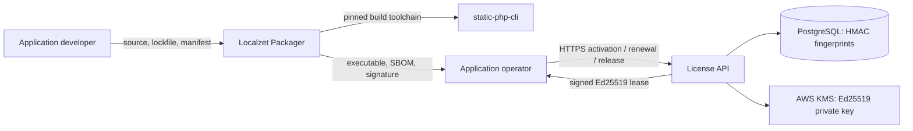
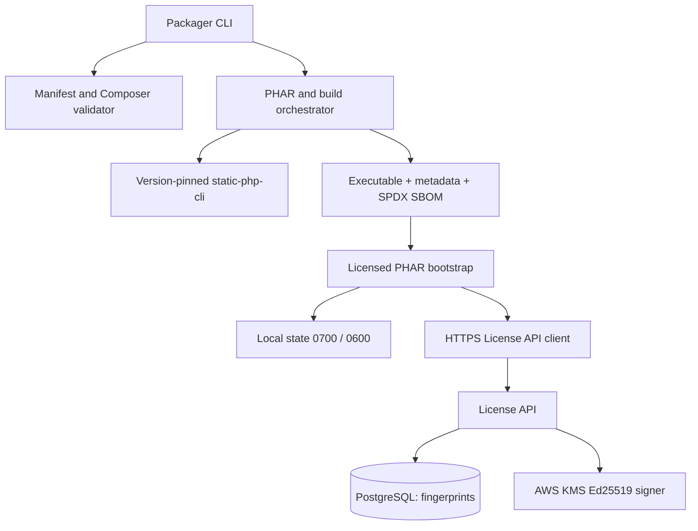

# Localzet Packager architecture

## Current state

Packager builds standalone executables for Linux x86-64 from a prepared production Composer graph. It validates the manifest and lockfile, creates a PHAR, probes the actual PHP runtime, and combines it with a pinned static-php-cli version. The output includes metadata, an SPDX 2.3 SBOM and a detached Ed25519 signature bundle.

Licensed builds include the activation client, strict Ed25519 JWS verification, protected file storage and lease enforcement at startup. The separate License API is implemented in a local private checkout and has unit and PostgreSQL integration coverage. It has not been published or deployed: production ingress, hostname, KMS key and end-to-end binary exchange remain unverified.

The [compatibility report](compatibility-spike.md) documents a Server 7 x86-64 smoke. Production TLS, ARM64, reproducible builds and independent artifact analysis are outside that check. PHAR does not encrypt PHP code or prevent reverse engineering.

## Context and boundaries

Packager turns a PHP application and its locked dependencies into an executable for the selected target. Builds run on a trusted machine and do not run Composer scripts or application code. Linux x86-64 is the only current target.

Approved license policy: the license determines the activation limit, defaulting to 1; clients revalidate online about every 24 hours with timing jitter; signed leases last no more than seven days. Once a lease expires, the application cannot start or the running Server worker group receives a graceful shutdown request. A new release requires online renewal to bind the lease to the new release and product version.

## C4 context

The License API source, migrations and OpenAPI contract exist locally. No public HTTPS endpoint or production KMS is configured; this diagram describes the intended operational connection, not a live production service.

## C4 containers

## License flow

1. The operator pipes the license key to `--license-activate`. The key is not written to local state; the API uses it to create the activation. Retries reuse the same idempotency key.
2. The executable stores a random installation ID, access token and lease in a private directory keyed by `product_id`. State survives release upgrades; the directory and files belong to the service user and use modes `0700/0600`.
3. Before loading the application, the bootstrap verifies the signature, issuer, `kid`, product, release, version, installation ID, expiry and next renewal time. The public key is pinned in the executable.
4. At the signed `renew_after` time, the client launches a separate process so HTTP does not block the event loop. Each Server worker checks API denial and the current lease once per second; a dedicated timer requests graceful shutdown at expiry.
5. Network failures permit operation until `exp`. An expired lease, permanent API rejection or release/version change requires successful renewal before startup. Manual `--license-renew` and `--license-release` commands are in the [CLI guide](cli.en.md).

The compact JWS uses `alg=EdDSA`, `typ=JWT` and a `kid` equal to SHA-256 of the raw Ed25519 public key in unpadded base64url. The key ID and public key are not secrets. The API stores HMAC fingerprints of license keys, access tokens and installation IDs; the private signing key stays outside the executable in KMS. The client stores its access token in a local `0600` file because it must present it for renewal and release.

## Security and operational limits

The build worker is not a sandbox for an untrusted project tree. Remove secrets and user data before packaging, review source and toolchain inputs, and use a dedicated worker with minimal privileges. A bundle signature proves integrity but does not by itself attest to build provenance.

Licensed runtimes require `curl`, `pcntl`, `posix`, `sodium`, an available `proc_open` function and Localzet Server 7+. Run under a dedicated service user when possible. If using `Server::$user`, pre-create the license state for the worker UID and activate as that user. `LOCALZET_LICENSE_DIR` selects the base directory; preserve its path and owner across upgrades.

Local clock changes affect expiry evaluation; signatures do not protect against an administrator who can alter clocks, files or the executable. License enforcement enables remote revocation and raises the cost of bypass, but it does not guarantee anti-tamper protection or prevent PHP source extraction.

## Architecture decisions

1. **Separate products.** Packager and License API are independent from Server and static-php-cli, with separate release lifecycles and key ownership.
2. **Pinned static-php-cli 2.x.** Check the toolchain version before a build and probe the actual micro runtime.
3. **Signed online lease.** Revalidate around every 24 hours, renew online and reject leases longer than seven days.
4. **Key and local state boundaries.** Only the public key ships in the executable. The API's private key stays in KMS; local tokens and leases use owner-only files. Idempotency keys constrain activation retries.
5. **Installation identity survives upgrades.** State is keyed by `product_id`; renewal signs the current release/version. Starting a changed binary requires connectivity.

## Release readiness

Implemented and checked locally: PHAR assembly, metadata and SBOM, detached Ed25519 signatures, strict JWS validation, activation/renew/release client, private state storage, fail-closed startup, graceful expiry shutdown and release-upgrade checks. The License API passed local unit and PostgreSQL integration tests.

Before customer release: configure the private Git remote and CI for License API; deploy HTTPS ingress that limits request bodies to 8 KiB before PHP; create the production KMS Ed25519 key and publish its key ID; run real activation/renew/revoke end-to-end checks; validate a clean build using real static-php-cli on Linux x86-64 and supported environments; approve license terms and data retention. Do not claim source extraction is prevented.
