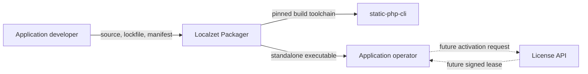
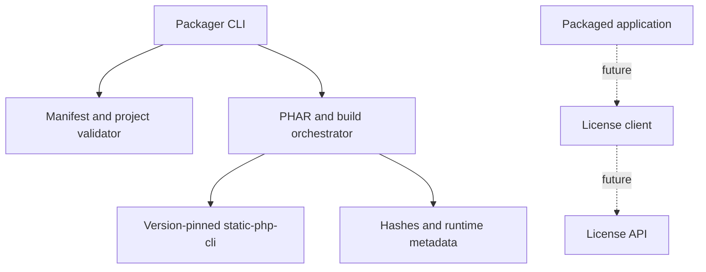

# Localzet Packager architecture

## Current implementation

The CLI currently targets Linux x86-64. It validates a manifest, a preinstalled production Composer tree and the configured `micro.sfx` runtime, creates a PHAR, and invokes the pinned static-php-cli version to combine the application and runtime. The builder emits an SPDX 2.3 SBOM from the validated production Composer lockfile with known dependency relationships and Composer PURLs; uncertain license data is `NOASSERTION`. Output metadata records hashes for the artifact, SBOM, runtime and Composer lockfile. Separate commands sign the binary, metadata and SBOM as one Ed25519 bundle and verify it against a supplied trusted public key. The [compatibility report](compatibility-spike.md) records one real Server 7 build and its acceptance evidence.

Provenance attestations, online activation, update delivery and additional targets are not implemented. Child processes are limited to 300 seconds. The rest of this document describes the intended product architecture and delivery stages, not current CLI features.

## Product context and boundaries

Packager is intended to turn a PHP application and its locked runtime dependencies into a standalone executable. It is a separate product so it can have its own toolchain, release schedule and commercial distribution controls. The activation service and legal terms for binary distribution are outside the current implementation.

Target capabilities include project and lockfile validation, target and extension selection, atomic artifact and metadata publication, signature verification, and activation with periodically refreshed signed leases. Non-goals include promising that PHP source cannot be recovered, running an untrusted multi-tenant build farm, billing, or changing the license of source libraries.

## C4 context

## C4 containers

## Data and security

The manifest records the project root, entrypoint, target, PHP version, required extensions, tool paths and output path. Packager does not resolve dependencies or execute Composer scripts; operators install production dependencies before the build. The CLI checks Composer lock and installed metadata, rejects dev dependencies, checks paths and symlinks, applies an input-size limit, verifies the toolchain version, and runs a capability probe against `micro.sfx`.

The SPDX SBOM inventories the validated production lockfile; it is not an independent source analysis or provenance attestation. Artifact signatures protect the bundle's hashes but do not identify a trusted key unless the verifier obtains its public key through a trusted channel. Keep release private keys outside the project tree and build worker. Build trusted source in an isolated worker: the current CLI is not a sandbox for hostile project files.

The planned license lease binds a product and artifact/customer identity to an expiry and key ID. Online activation with periodic revalidation and up to seven days of offline operation after the last successful check are approved requirements. The revalidation interval, protocol and privacy/retention terms remain undecided. The client, API, lease validation, storage and revocation are not implemented. No packaging technique can guarantee that embedded PHP source is unrecoverable.

## Architecture decisions

1. **Separate product.** Keep Packager independent from Server and upstream static-php-cli.
2. **Pinned static-php-cli 2.x backend.** Keep the backend version explicit; verify the produced runtime rather than assuming its extension set.
3. **Online license revalidation.** Use signed, expiring leases with up to seven days of offline operation after the last successful check. Keep private signing keys outside generated binaries; define the online interval and protocol before implementation.

## Delivery stages

1. **Compatibility:** Linux x86-64 has a local Server 7 build, runtime probe, two-worker HTTP check and SIGINT shutdown check. Clean-host libraries, ARM64, TLS and network/proxy behavior remain open.
2. **Build pipeline:** manifest validation, PHAR assembly, pinned tool invocation, SPDX 2.3 SBOM and artifact hashes are implemented. Fixture tests cover traversal, symlinks, development dependencies, missing extensions, signature verification and tamper rejection.
3. **Provenance:** define an attestation format, release-key custody and rotation procedure, independent SPDX validation, and reproducible-build analysis.
4. **Licensing:** test valid, expired, revoked and tampered leases, network failures, retry policy, offline grace and clock changes against a mock service before building a production API.
5. **Release:** add supported target artifacts, clean-host tests, support and rollback procedures, public documentation and legal review of binary distribution terms.

Packager is not release-ready until these gates pass on every supported target. A successful build or CI run alone does not prove clean-host compatibility, source protection or license enforcement.
