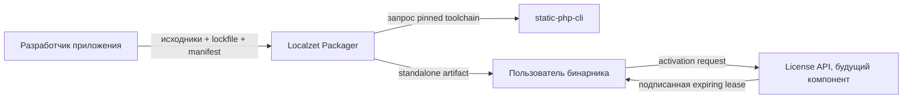
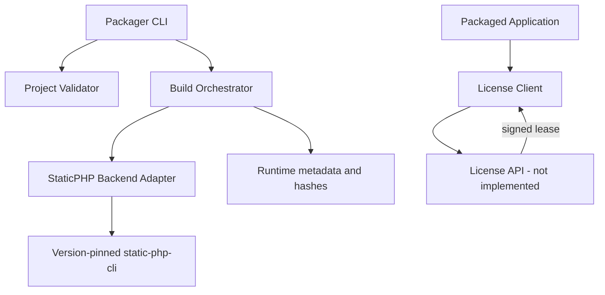

# Архитектура Localzet Packager

## Текущее состояние

Реализован CLI для одной цели: Linux x86-64. Он проверяет manifest, готовые production-зависимости Composer и runtime `micro.sfx`, создаёт PHAR и запускает static-php-cli для объединения файлов. Metadata содержит хеш артефакта, `micro.sfx` и `composer.lock`, версию PHP, список загруженных и обязательных расширений, target и версию toolchain. Актуальная сборка Server 7 прошла HTTP, TLS, два worker-процесса и SIGINT в `scratch` без системных библиотек; подробности приведены в [отчёте о совместимости](compatibility-spike.md) и [его русской версии](compatibility-spike.ru.md).

Генерация SPDX 2.3 SBOM по production Composer lockfile реализована; он включает приложение, известные пакеты и SHA-256 артефакта, а metadata содержит SHA-256 SBOM. Неподтверждённые данные о лицензиях передаются как `NOASSERTION`. Отдельные команды создают Ed25519 подпись комплекта «бинарник + metadata + SBOM» и проверяют её по переданному доверенному публичному ключу. Модель подписанной license lease проверяет Ed25519-подпись, идентификаторы продукта, версии и установки, период действия и максимальный срок в семь дней. Сетевой клиент, файловый cache, интеграция в PHAR, API сервиса активации и enforcement в работающем процессе пока не реализованы. Provenance attestations и доставка обновлений также не реализованы. Вызовы дочерних процессов ограничены таймаутом 300 секунд. Остальные разделы этого документа описывают целевую архитектуру и этапы, а не существующие возможности CLI.

## Бизнес-контекст

Packager выдаёт автономное приложение для выбранной платформы из PHP-проекта и закреплённого dependency graph. Ценность — упрощённая установка на целевом сервере и контролируемая выдача коммерческих артефактов. Это отдельный продукт; сервер активации и юридические условия лицензии пока не входят в реализацию.

## Требования и границы

Целевые функции: проверка проекта и `composer.lock`; сборка по target и extension manifest; атомарная выдача артефакта и metadata; проверка подписи; активация и обновление подписанной lease. Владелец продукта утвердил онлайн-перепроверку лицензии каждые 24 часа и офлайн-допуск до 7 дней после последней успешной проверки. Lease должна подписываться сервером и включать срок действия не более 7 дней; закрытый ключ подписи остаётся только на сервере. Сетевой протокол и сервер активации ещё не реализованы.

NFR: одинаковые входы должны давать проверяемые артефакты; сборка не должна запускать сетевой код проекта; build worker изолирован; таймауты и размер входа ограничены; клиент лицензии не содержит серверных секретов; ошибки активации диагностируемы без вывода токенов.

Вне scope MVP: невозможность reverse engineering, Windows/macOS targets, production license service, billing, multi-tenant build farm и смена лицензии исходных библиотек.

## C4 — Context

## C4 — Containers

## Application / data

Build input manifest records project root, entrypoint, target OS/architecture, PHP version and explicit extensions. The current CLI does not resolve Composer dependencies: the operator installs production dependencies beforehand, and the builder checks the installed tree against its metadata and lockfile. Current output metadata records tool versions, runtime version and loaded extensions, extension requirements, target and SHA-256 hashes. The builder emits an SPDX 2.3 SBOM from the validated production Composer lockfile with Composer PURLs and known dependency relationships; uncertain license information is `NOASSERTION`. A separate release key can sign the binary, metadata and SBOM hashes; the signature file does not include a trusted public key. Provenance attestation and source revision binding are not yet implemented. Do not store secrets or user credentials in manifest/SBOM.

Модель lease принимает JSON envelope с полями `payload` и `signature`. Payload содержит `schema_version: 1`, `algorithm: "Ed25519"`, `key_id`, `product_id`, `release_id`, `installation_id`, `issued_at` и `expires_at`; дополнительных полей быть не должно. `key_id` — lowercase hex SHA-256 от открытого ключа, а доверенный набор задаётся как `key_id` → base64(raw public key). Подпись покрывает компактный JSON payload с фиксированным порядком полей: `schema_version`, `algorithm`, `key_id`, `product_id`, `release_id`, `installation_id`, `issued_at`, `expires_at`. Валидатор отклоняет неизвестные ключи, лишние или отсутствующие поля, несовпадение идентификаторов, некорректную подпись, истёкший lease и срок действия более семи дней. `expires_at` также ограничен семью днями от момента проверки, поэтому допуск рассогласования часов не удлиняет офлайн-период. Для рассогласования часов допускается `issued_at` не более чем на пять минут в будущем; после `expires_at` дополнительного допуска нет. Утверждённая политика требует онлайн-перепроверку каждые 24 часа и разрешает офлайн до семи дней после последней успешной проверки. Модель пока не загружает и не сохраняет lease и не управляет работой приложения. Клиент, сервис активации, отзыв и условия хранения данных не реализованы. Закрытый ключ сервера не должен попадать в бинарник.

## Infrastructure / threat model

The current builder uses a private temporary directory and does not invoke Composer or application code. A mock activation API is not implemented. Builds must not run on a privileged shared worker. Threats include malicious project files, crafted paths, dependency drift, stolen signing key, cloned binaries, clock rollback, activation outage, tampered executable and source extraction. Current controls include path and symlink checks, Composer dev-dependency rejection, input-size limits, a pinned toolchain version check, an actual runtime capability probe, 300-second subprocess timeouts, and optional detached signatures over release hashes. Key custody, rotation, trusted public-key distribution, build isolation and signed license leases remain operational or future work. No control makes embedded PHP source unrecoverable.

Expected initial load is developer-triggered builds (low/variable); build resource cost dominates and is isolated per job. Activation API capacity and availability targets are deferred until service scope is approved.

## ADRs

### ADR-001: Separate packager product

Chosen: separate repository/product rather than modifying Server or static-php-cli. This keeps release lifecycles and upstream toolchain boundaries clear.

### ADR-002: static-php-cli v2 backend first

Chosen: pin stable 2.x behind an adapter. Do not target alpha major versions. A compatibility spike must verify Server worker lifecycle, sockets, TLS and extensions before implementing broad packaging features.

### ADR-003: Signed online activation lease

Chosen direction: online activation revalidated every 24 hours, with up to seven days offline after the last successful check. Leases are server-signed and valid for no more than seven days; the server private signing key must stay outside generated executables. The activation protocol, privacy terms and legal license terms remain open.

## Delivery stages and readiness

1. Toolchain compatibility spike: x86-64 Server 7 build, PHP/extensions probe, two-worker HTTP/TLS and SIGINT passed in a `scratch` container without system libraries. Production certificate loading, ARM64 and network/proxy behavior remain open.
2. CLI build pipeline: manifest and lock metadata validation, pinned builder, executable artifact, SPDX 2.3 SBOM and hashes are implemented. `composer check` validates generated SBOM fixtures against the pinned official SPDX 2.3.1 JSON Schema and rejects a malformed document; semantic SPDX validation and verification by a separately maintained artifact verifier remain open. Traversal, symlink, development dependency and missing-extension cases have fixture coverage.
3. **Подпись артефактов:** Ed25519 подпись комплекта и отказ при изменении бинарника, metadata или SBOM покрыты тестами. Provenance attestations, безопасная операционная процедура хранения/ротации release keys и анализ воспроизводимости ещё нужны.
4. **Модель lease:** строгая проверка Ed25519-подписи и привязки к продукту, версии и установке реализована и покрыта локальными регрессионными тестами. Осталось реализовать mock API, безопасное атомарное хранилище, timeout/retry, отзыв, runtime enforcement, границы офлайн-режима и тесты отката часов.
5. Release: supported-target artifacts and clean-host checks for each target, CI matrix, docs, support/rollback runbook and explicit legal review of binary distribution terms.

Ready means no source PHP runtime on clean targets, HTTP/TCP and graceful shutdown pass on both architectures, malformed/tampered metadata fails closed, no signing secret ships in artifact, SBOM/signature verify, and a fresh independent build/review passes. No stage is complete based on configuration or compilation alone.
