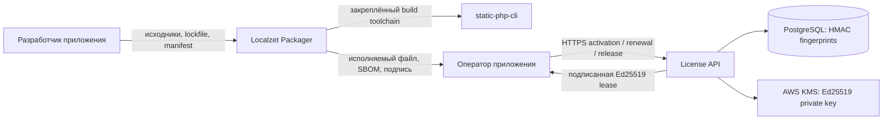
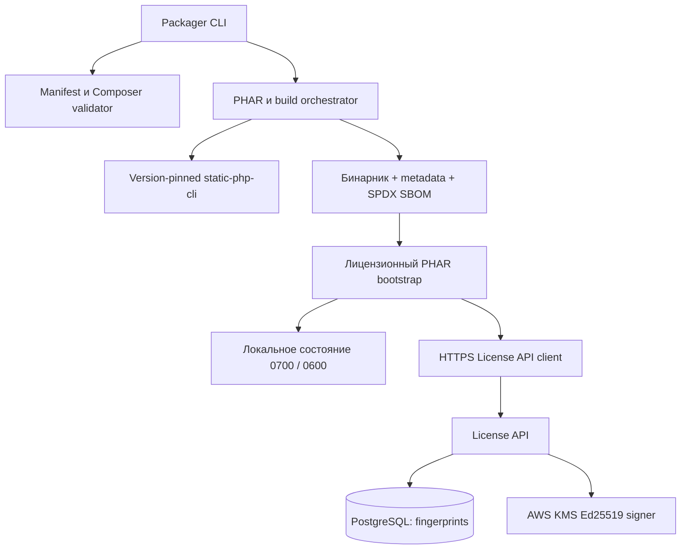

# Архитектура Localzet Packager

## Текущее состояние

Packager собирает автономные исполняемые файлы для Linux x86-64 из подготовленного production Composer-графа. Он проверяет manifest и lockfile, создаёт PHAR, проверяет реальный PHP runtime и объединяет его закреплённой версией static-php-cli. Результат сопровождается metadata, SPDX 2.3 SBOM и отдельной Ed25519-подписью комплекта.

Лицензируемые сборки встраивают API-клиент, строгую проверку Ed25519 JWS, защищённое файловое состояние и контроль lease при запуске. Модуль License API реализован в отдельном приватном локальном checkout и покрыт unit и PostgreSQL integration тестами. Он ещё не опубликован и не развёрнут: production ingress, hostname, KMS key и end-to-end обмен с бинарником не проверены.

Подтверждённая совместимость Server 7 для x86-64 описана в [отчёте](compatibility-spike.md). Production TLS, ARM64, воспроизводимые сборки и независимый анализ артефактов остаются за рамками выполненной проверки. PHAR не шифрует PHP-код и не исключает reverse engineering.

## Контекст и границы

Packager превращает PHP-приложение и его закреплённые зависимости в исполняемый файл для выбранного target. Сборка выполняется на доверенной машине и не запускает Composer-скрипты или код приложения. Поддерживается только Linux x86-64.

Лицензионные решения, утверждённые владельцем продукта: лимит активаций хранится в лицензии и по умолчанию равен 1; клиент перепроверяет право через API примерно каждые 24 часа с разбросом времени; подписанная lease действует не дольше семи дней. При истечении lease приложение не запускается либо Server получает запрос штатно завершить worker-группу. Выпуск новой версии требует online renewal для привязки lease к новому release/product version.

## C4 — контекст

License API исходники, миграции и OpenAPI существуют локально. На дату последней проверки публичный HTTPS endpoint и production KMS не настроены; схема показывает целевую эксплуатационную связь, а не действующий production сервис.

## C4 — контейнеры

## Поток лицензии

1. Оператор передаёт license key в stdin команды `--license-activate`. Ключ не записывается в state; API использует его только для выдачи активации. Повтор сетевой попытки использует тот же idempotency key.
2. Бинарник сохраняет случайный installation ID, access token и lease в приватном каталоге, привязанном к `product_id`. Данные сохраняются между release upgrades; каталог и файлы принадлежат системному пользователю и имеют режимы `0700/0600`.
3. Перед приложением bootstrap проверяет подпись, издателя, `kid`, product, release, version, installation ID, срок и срок следующей проверки. Публичный ключ закреплён в бинарнике.
4. Когда наступает подписанный `renew_after`, клиент запускает renewal отдельным процессом, чтобы HTTP не блокировал event loop. Server worker каждые секунду проверяет отказ API и актуальный срок lease; отдельный таймер запрашивает graceful shutdown в момент истечения.
5. Сетевой сбой допускает работу до `exp`. Истёкшая lease, постоянный отказ API или переход на новый release/version требует успешного renewal до запуска. Ручные команды `--license-renew` и `--license-release` описаны в [CLI guide](cli.md).

Компактный JWS использует `alg=EdDSA`, `typ=JWT` и `kid`, равный SHA-256 открытого Ed25519 ключа в unpadded base64url. `kid` и публичный ключ не являются секретами. API хранит HMAC-отпечатки лицензий, access tokens и installation IDs; приватный signing key остаётся вне бинарников в KMS. Клиент хранит access token в локальном файле `0600`, потому что ему нужно предъявлять его для продления и отзыва.

## Безопасность и эксплуатационные ограничения

Build worker не является sandbox для недоверенного дерева проекта. Убирайте секреты и пользовательские данные до упаковки, проверяйте исходники и toolchain, используйте отдельный worker с минимальными правами. Подпись бандла подтверждает целостность, но сама по себе не удостоверяет происхождение сборки.

Лицензируемому runtime нужны `curl`, `pcntl`, `posix`, `sodium`, доступный `proc_open` и Localzet Server 7+. Не запускайте приложение от root, если можно назначить системного пользователя. При конфигурации `Server::$user` activation state должен заранее принадлежать UID worker-а, а активацию следует выполнять от этого пользователя. Переменная `LOCALZET_LICENSE_DIR` задаёт базовый каталог; сохраняйте путь и owner между обновлениями.

Локальные часы влияют на оценку срока; подпись не защищает от администратора, способного менять часы, файлы или сам бинарник. Лицензионный enforcement повышает стоимость обхода и управляет удалённым отзывом, но не даёт гарантии anti-tamper и не защищает PHP исходники от извлечения.

## Архитектурные решения

1. **Отдельные продукты.** Packager и License API независимы от Server и static-php-cli; у них свои релизы и границы владения ключами.
2. **Закреплённый static-php-cli 2.x.** Версия toolchain проверяется перед сборкой, а состав micro runtime — фактическим probe.
3. **Подписанная online lease.** Клиент проверяет подписанный срок каждые ~24 часа, использует online renewal и не принимает lease дольше семи дней.
4. **Ключи и локальное состояние.** В бинарнике хранится только публичный ключ. На API стороне приватный ключ находится в KMS; локальные токен и lease имеют owner-only права. Повтор активации ограничен idempotency key.
5. **Идентичность установки переживает обновления.** State каталог адресуется по `product_id`, а renewal заново подписывает право для текущего release/version. Изменение бинарника требует сети до запуска.

## Готовность к выпуску

Реализовано и локально проверено: сборка PHAR, metadata и SBOM, detached Ed25519 signatures, строгая проверка JWS, активация/renew/release client, приватный state store, fail-closed startup, graceful expiry shutdown и проверки обновления release. License API проверен локальными unit и PostgreSQL integration тестами.

До клиентского выпуска остаются: настроить приватный Git remote и CI для License API; развернуть HTTPS ingress с ограничением request body до 8 KiB до PHP; создать production KMS Ed25519 key и публичный key ID; провести реальное activation/renew/revoke E2E тестирование; проверить чистую сборку реального static-php-cli на Linux x86-64 и поддерживаемых окружениях; утвердить пользовательские условия лицензии и retention policy. Не считать исходники защищёнными от извлечения.
