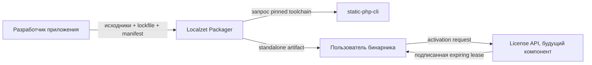
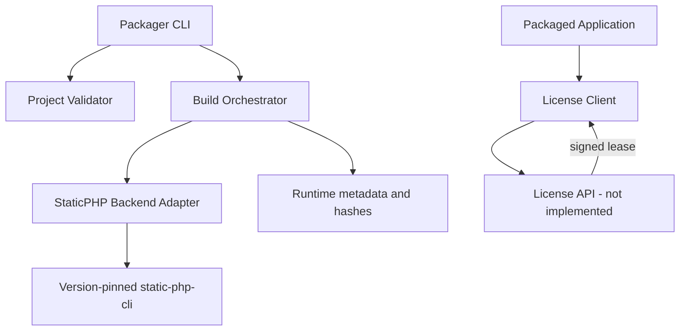

# Архитектура Localzet Packager

## Текущее состояние

Реализован CLI для одной цели: Linux x86-64. Он проверяет manifest, готовые production-зависимости Composer и runtime `micro.sfx`, создаёт PHAR и запускает static-php-cli для объединения файлов. Metadata содержит хеш артефакта, `micro.sfx` и `composer.lock`, версию PHP, список загруженных и обязательных расширений, target и версию toolchain. Подробности фактического прогона приведены в [отчёте о совместимости](compatibility-spike.md).

Генерация SBOM, подпись и подтверждение происхождения сборки, online-активация и доставка обновлений пока не реализованы. Вызовы дочерних процессов ограничены таймаутом 300 секунд. Остальные разделы этого документа описывают целевую архитектуру и этапы, а не существующие возможности CLI.

## Бизнес-контекст

Packager выдаёт автономное приложение для выбранной платформы из PHP-проекта и закреплённого dependency graph. Ценность — упрощённая установка на целевом сервере и контролируемая выдача коммерческих артефактов. Это отдельный продукт; сервер активации и юридические условия лицензии пока не входят в реализацию.

## Требования и границы

Целевые функции: проверка проекта и `composer.lock`; сборка по target и extension manifest; атомарная выдача артефакта и metadata; проверка подписи; активация и обновление подписанной lease. Владелец продукта утвердил онлайн-проверку лицензии и офлайн-период до 7 дней после последней успешной проверки; периодичность online-проверки и детали протокола ещё требуется определить.

NFR: одинаковые входы должны давать проверяемые артефакты; сборка не должна запускать сетевой код проекта; build worker изолирован; таймауты и размер входа ограничены; клиент лицензии не содержит серверных секретов; ошибки активации диагностируемы без вывода токенов.

Вне scope MVP: невозможность reverse engineering, Windows/macOS targets, production license service, billing, multi-tenant build farm и смена лицензии исходных библиотек.

## C4 — Context

## C4 — Containers

## Application / data

Build input manifest records project root, entrypoint, target OS/architecture, PHP version and explicit extensions. The current CLI does not resolve Composer dependencies: the operator installs production dependencies beforehand, and the builder checks the installed tree against its metadata and lockfile. Current output metadata records tool versions, runtime version and loaded extensions, extension requirements, target and SHA-256 hashes. It does not yet produce a dependency inventory, SBOM, source revision, signature or provenance attestation. Do not store secrets or user credentials in manifest/SBOM.

The planned license lease is a versioned signed payload with product, artifact/customer binding, expiry, key id and optional revocation epoch. Signature verification uses an embedded public key; the client stores leases atomically with least-privilege filesystem permissions. Online activation with periodic revalidation and up to seven days of offline operation after the last successful check are approved product requirements. Revalidation frequency, activation protocol and privacy/retention terms remain undecided. The license client and service are not implemented.

## Infrastructure / threat model

The current builder uses a private temporary directory and does not invoke Composer or application code. A mock activation API is not implemented. Builds must not run on a privileged shared worker. Threats include malicious project files, crafted paths, dependency drift, stolen signing key, cloned binaries, clock rollback, activation outage, tampered executable and source extraction. Current controls include path and symlink checks, Composer dev-dependency rejection, input-size limits, a pinned toolchain version check, an actual runtime capability probe and 300-second subprocess timeouts. Isolation, signed leases/artifacts, bounded retries and key rotation remain future work. No control makes embedded PHP source unrecoverable.

Expected initial load is developer-triggered builds (low/variable); build resource cost dominates and is isolated per job. Activation API capacity and availability targets are deferred until service scope is approved.

## ADRs

### ADR-001: Separate packager product

Chosen: separate repository/product rather than modifying Server or static-php-cli. This keeps release lifecycles and upstream toolchain boundaries clear.

### ADR-002: static-php-cli v2 backend first

Chosen: pin stable 2.x behind an adapter. Do not target alpha major versions. A compatibility spike must verify Server worker lifecycle, sockets, TLS and extensions before implementing broad packaging features.

### ADR-003: Signed online activation lease

Chosen direction: online activation with periodic revalidation and up to seven days offline after the last successful check. The exact revalidation interval, protocol, privacy terms and legal license terms remain open. The server private signing key must stay outside generated executables.

## Delivery stages and readiness

1. Toolchain compatibility spike: x86-64 Server 7 build, PHP/extensions probe, two-worker HTTP and SIGINT have passed locally. Clean-host libraries, ARM64, TLS and network/proxy behavior are open.
2. CLI build pipeline: manifest and lock metadata validation, pinned builder, executable artifact and hashes are implemented. SBOM and independent artifact verification are open. Traversal, symlink, development dependency and missing-extension cases have fixture coverage.
3. Signed provenance: verify signature/hash tamper rejection and reproducible build properties where toolchain permits.
4. License client protocol: mock activation, valid/expired/revoked/tampered lease, timeout, retry, offline grace, clock rollback and atomic cache tests.
5. Release: Linux x86-64 and ARM64 artifacts, clean-host smoke, CI matrix, docs, support/rollback runbook and explicit legal review of binary distribution terms.

Ready means no source PHP runtime on clean targets, HTTP/TCP and graceful shutdown pass on both architectures, malformed/tampered metadata fails closed, no signing secret ships in artifact, SBOM/signature verify, and a fresh independent build/review passes. No stage is complete based on configuration or compilation alone.
